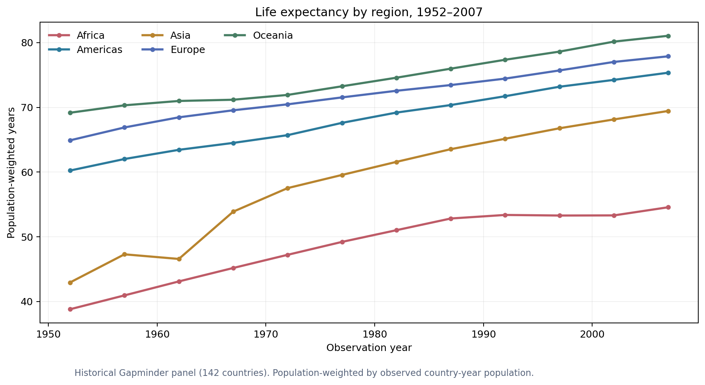
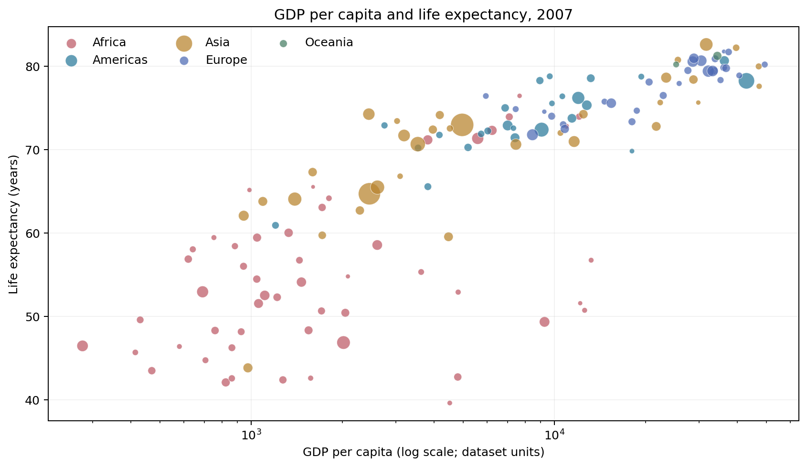

# Global Development Data Analytics 🌍

### Country-level life expectancy, GDP per capita & regional disparities | 1952–2007

**Python • pandas • SQL/SQLite • exploratory statistics • Matplotlib • Plotly • automated tests**

[View the case study](CASE_STUDY.md) · [Data dictionary](DATA_DICTIONARY.md) · [Publishing guide](HOW_TO_PUBLISH.md) · [LinkedIn copy](LINKEDIN_TEXT.md)

> **Historical-data note:** This project explores a real 1952–2007 Gapminder dataset. Do not present findings as current. The included 142 countries are not every country in the world.

## Dashboard preview



[Open the offline interactive dashboard](dashboard/index.html) (download/open the file locally; GitHub's code viewer does not execute interactive HTML).

## Questions answered

- How did population-weighted life expectancy change between 1952 and 2007?
- How did the patterns differ across continents?
- What was the relationship between life expectancy and GDP per capita across countries in 2007?
- Which countries saw the largest changes in life expectancy?
- How do population-weighted and unweighted aggregates differ?

## Verified results

| Indicator | Result | Meaning |
| --- | ---: | --- |
| Records | 1,704 | 142 countries × 12 five-year observations |
| Population-weighted life expectancy, 1952 | 48.94 years | Average over represented population |
| Population-weighted life expectancy, 2007 | 68.92 years | Same calculation, different year |
| Difference | +19.97 years | Descriptive change between endpoint snapshots |
| Spearman rho (2007) | +0.857 | Country-level GDP per capita vs life expectancy |

**Interpretation:** Income and life expectancy were positively associated across countries in the 2007 snapshot; this does not imply GDP growth *caused* life expectancy changes. Calculations are reproducible with `python run_all.py`.



## Reproduce locally

Requires Python 3.10+ (recommended Python 3.11).

```bash
python -m venv .venv
# On Windows: .venv\Scripts\activate
# On macOS/Linux: source .venv/bin/activate
pip install -r requirements.txt
python -m unittest discover -s tests -v
python run_all.py
```

Open `dashboard/index.html` in a browser to explore the charts offline. Run `jupyter notebook notebooks/01_development_analytics.ipynb` if you prefer notebook-based learning.

## Structure

```text
global-development-analytics/
├── README.md                         # Problem, findings and workflow
├── CASE_STUDY.md                     # Statistical interpretation and limitations
├── DATA_DICTIONARY.md                # Source fields and KPI definitions
├── HOW_TO_PUBLISH.md                 # GitHub + LinkedIn instructions
├── LINKEDIN_TEXT.md                  # Adaptable project description
├── data/
│   ├── gapminder_1952_2007.csv       # Historical panel from Plotly/Gapminder
│   └── development.sqlite            # Automatically produced SQLite DB
├── notebooks/01_development_analytics.ipynb
├── src/analytics.py                  # Validation and analytics
├── src/charts.py                     # Figures and offline dashboard
├── sql/analyst_queries.sql           # SQL examples (CTEs, windows, aggregates)
├── tests/test_analytics.py           # Reproducibility tests
├── reports/
│   ├── metrics.json
│   ├── annual_summary.csv
│   ├── regional_summary.csv
│   ├── country_changes.csv
│   └── figures/*.png
├── dashboard/index.html              # Standalone interactive visualization
├── docs/index.html                   # GitHub Pages-ready copy of dashboard
└── .github/workflows/python-checks.yml
```

## Data provenance and usage

The historical data were provided via `plotly.express.data.gapminder()`. Original dataset context: [Gapminder](https://www.gapminder.org/data/) and [Plotly data module](https://plotly.com/python/px-arguments/). Figures and analysis code in this repository are an educational portfolio project. Original data remains subject to its source conditions and attribution requirements.

The word “global” in the title refers to cross-region scope, **not complete global country coverage**. Countries are not a random sample; region-level and statistical inferences are limited. The 2007 Oceania aggregate covers two countries only.

## Project ownership

Use this as a learning scaffold: review, rerun and modify the analysis, write your own interpretation and acknowledge any assistance. Do not represent it as independently completed work until you actually work through it.
